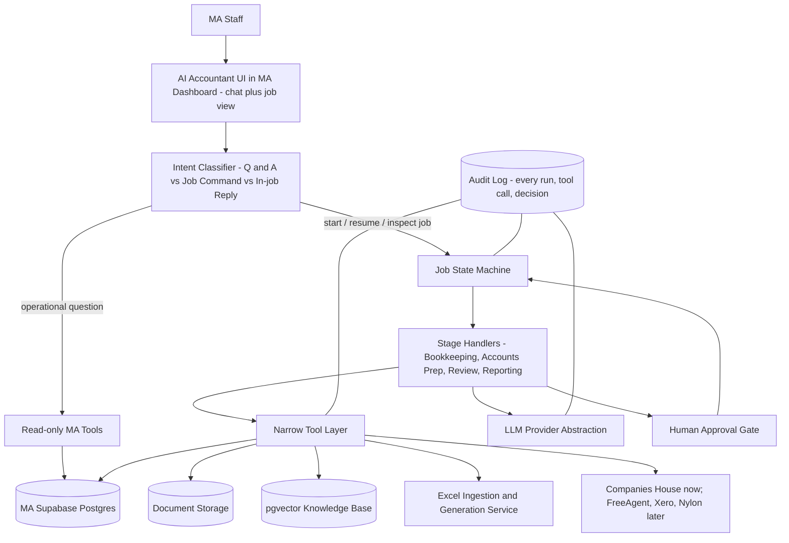

# 2. Architecture — what it looks like and what it contains

This is the actual design. Every piece is explained on its own so you can point at any
one of them and know what it does, why it exists, and what it depends on.

## 2.0 The one-sentence architecture

> A deterministic, auditable **workflow engine** that mirrors MA's real accounting
> process, calling **narrow AI agents** only for the steps that genuinely require
> judgement, backed by MA's own database and documents as the source of truth, with a
> human approval gate before anything becomes final.

## 2.1 The three layers



**Layer 1 — Presentation.** The existing Next.js MA app, plus a new "AI Accountant"
area. Chat UI built with the Vercel AI SDK (fits the existing frontend, supports
tool-call/approval UX natively). This is where staff type "Start the year-end accounts
for ABC Ltd" or "What jobs are overdue?" See §2.1.1 for the concrete workflow/UI
design (chat vs. dashboard, notifications, output format, exception review).

### 2.1.1 Workflow / UI design — decided 25 Aug 2026 (Point 3)

From the 23 Aug meeting, Faraz walked through the actual scenario he wants: tell
the AI to start a job, know what's happening while it runs, and know exactly where
to find the result when it's done. Mirza's answer on the call was "both" — a chat
experience and a dashboard experience — plus a Phase 3 idea for a per-client
history view ("a little portal for each client"). The following locks that down
into a concrete design, confirmed with Mirza on 25 Aug 2026:

**1. Chat and exception review are separate surfaces, not one thread.**
Chat is for starting a job and ad-hoc questions ("start year-end for ABC Ltd,"
"what's overdue this week"). The **exception review is a structured table**, not
part of the chat transcript — a 1,200-transaction job with 100+ flagged lines is
unusable as a chat log. This also keeps the intent-router split in §2.3 clean:
job commands, operational Q&A, and in-job replies (an answer to a flagged
exception) are still three different paths, but exceptions get their own review
UI rather than being dropped back into the chat.

**2. Job status is a fixed, small lifecycle**, shown as a badge everywhere a job
appears (sidebar, job list, notifications):

```
Queued → Processing → Needs your input → Ready for review → Approved
```

No custom per-job status strings. Every job is always in exactly one of these five
states. "Needs your input" is what fires when an exception needs a human answer to
continue; "Ready for review" is after the deterministic gates (TB balances, bank
rec agrees) have already passed — see §2.13 liability boundary.

**3. Notifications: both email and in-app** (confirmed 25 Aug 2026). A job moving
into "Needs your input" or "Ready for review" sends an email (reusing the existing
Resend infrastructure already in the MA app — no new notification system) and
shows an in-app badge/count on the AI Accountant nav item. This directly answers
Faraz's "we come back to it one hour later" scenario — MA does not need to poll a
tab.

**4. Output format: MA's actual Excel template + a one-page PDF summary**
(confirmed 25 Aug 2026), both generated once a job reaches "Ready for review" and
both downloadable from the job's page. The PDF is for a quick glance (the numbers
Faraz asked about — "Adobe, PDF, an Excel workbook?"); the Excel is the real
working file, matching MA's tabs/formulas (§2.12). Both are also stored in
`ai_documents` so nothing depends on a browser download surviving.

**5. Per-client AI job history ("the portal") stays Phase 3** (confirmed, matches
Mirza's original placement in the meeting). It is not a separate build — it is the
same job-list UI from Phase 1, scoped to one client and kept historically, plus a
filter. Framing it that way avoids over-promising a new system; it is a query and
a view on data that already exists from Phase 1 onward.

**6. Screenshots before final layout commitment.** Faraz explicitly asked for
this ("until we're actually sitting there using it... it's hard for me to say one
way is correct"). Do not treat the mockup in the proposal as final — ship real
screenshots once the job-creation flow and exception table exist, and expect
layout feedback at that point, not before.

**Layer 2 — Orchestration.** A **deterministic job state machine** — not a free-roaming
agent that decides its own next step. It owns `current_stage` for each AI job, only
allows specific transitions, gates transitions on validation checks and human
approvals, and calls the right stage handler. Lives as Postgres tables plus a thin
service layer.

**Layer 3 — Execution.** Python service(s) implementing each stage handler:
gather context via tools → run deterministic checks → call the LLM only where genuine
judgement is needed → produce a structured output → validate → persist. Agents never
talk to each other in natural language — they only read/write the shared job record in
Postgres.

## 2.2 Why not just "an AI agent that figures it out"

Because the accounting process the client gave us (the flowchart) is a **regulated,
mostly-linear sequence with a handful of binary decisions** — not a case where agents
need to freely negotiate or invent their own order of operations. If an LLM is allowed
to decide "maybe I'll skip reconciliation this time," that is exactly the loss of
control the client said they don't want. So: the **sequence** of the accounting process
is fixed by code (the state machine); **judgement calls inside a given step** (which
account does this transaction belong to?) are where the LLM is used.

## 2.3 Intent routing vs. job execution — two different things

- **"What jobs are overdue?" / "Which clients haven't sent their information?"** → this
  is an **operational question**. It goes to a small set of read-only tools that query
  the MA database directly and answer in the chat. No job, no workflow, no agent
  pipeline.
- **"Start the year-end accounts for ABC Ltd." / "Here's the paperwork, start the
  job."** → this is a **job command**. It creates/opens an AI job row, and the state
  machine takes over from there.
- **A reply while a job is paused waiting for a human** (e.g. answering an exception)
  → routed back into the paused job, not treated as a new conversation.

A small intent classifier at the very front of the chat (can be a single cheap LLM call
with a fixed set of allowed intents, or a simple rules/embedding classifier) decides
which of these three paths a message goes down. This separation is one of the most
important design decisions in the whole system — mixing "chatting with the AI" and
"running the accounting pipeline" together is a common and costly mistake.

## 2.4 The workflow engine (state machine)

This is the accounting process from the flowchart, encoded as states:


Each arrow is a **controlled transition** — the code decides whether the job is allowed
to move to the next box, based on a validation result or a recorded human approval.
Nothing skips a step.

**Framework decision — confirmed (see [08-decisions-log.md](./08-decisions-log.md),
Decision 1):** a **custom Postgres-backed state machine**. A `current_stage` column on
`ai_jobs`, an explicit table/switch of allowed transitions, and a transition function.
Runs on Postgres, which the team already owns and understands — no new framework to
learn or get locked into. LangGraph (a workflow framework offering built-in durable
checkpointing and "pause here, resume later" support) was considered and consciously
not chosen — this workflow doesn't need most of what a full agent-framework gives you,
and one fewer framework is one fewer thing to debug and one fewer place to get locked
in. See [03-review-of-gpt-plan.md](./03-review-of-gpt-plan.md) §3.2 for the full
reasoning.

## 2.5 What's an "agent" vs. what's just code

Mapped against every decision point in the flowchart:

- **Always deterministic code, never an LLM call:**
  - Already Excel/CSV? (file type check)
  - Prior file exists? (database/storage lookup)
  - Account exists? (exact/fuzzy match against the chart of accounts)
  - Is the client VAT registered? (already a field on `companies`/`vat_clients`)
  - Debits = credits?
  - Bank reconciliation agrees?
  - Do accounts/pages agree to the trial balance?
- **Deterministic first, LLM only as a fallback/tie-break:**
  - Which prior file counts as "similar" if there's no exact prior file — shortlist by
    job type + industry/tag deterministically, LLM only picks among the shortlist.
  - Matching a transaction to supporting documents — deterministic candidate matching
    by amount/date/payee first, LLM only judges ambiguous candidates or reads
    unstructured invoice text.
- **LLM does the real work, but always retrieval-first:**
  - Assigning a transaction to a P&L/Balance Sheet account — first check "has this
    exact supplier/description been mapped before for this client" (deterministic
    lookup, wins if found), then "does a firm rule already cover this," and only then
    let the LLM decide.
  - VAT treatment/code for a transaction — same retrieve-first pattern.
  - Judgement items in the internal review checklist ("does this treatment look
    right") — raises an exception for a human, never silently resolves.

This mapping is the actual meaning of "don't use an LLM when code can answer it" —
applied line-by-line to the client's own flowchart, not left abstract.

## 2.5.1 Categorisation chain (working design — keep tightening)

Status: **in progress**. This is the live Phase 1 workstream. Do not freeze the
prompt and walk away. Keep improving until exception questions are specific and
auto-classified lines match MA's completed files at an agreed rate.

Every bank line goes through this order. Later steps never run if an earlier one
already has a high-confidence answer.

1. **Prior client mapping** — has this supplier/description been mapped for this
   client before? Database lookup. If yes, use it. No LLM.
2. **Firm rule** — does an approved firm-wide rule cover this? Database lookup.
3. **LLM judgement** — only if 1 and 2 miss. Propose account + VAT + confidence.
   Must also propose a **question** when confidence is below threshold, e.g.
   "Emirates flights on a car-wash client — travel or personal? Confirm."
   The AI asks; it does not silently post a guess.
4. **Nylon validation (Phase 2+, optional, low priority)** — if a developer API
   exists and LLM confidence is borderline, call
   `validate_categorisation(description, proposed_account, client_context)`.
   Nylon does not block Phase 1. If it has no useful answer, still go to step 5.
   Qasim's own assessment (23 Aug 2026 meeting): HMRC publishes a defined list
   of roughly 500 allowable expense categories that most transactions map onto
   cleanly, and a plain LLM already gets most of these right without extra
   tooling — Nylon is not needed for the common case, only potentially for
   complex edge cases later. Treat as a nice-to-have, not a dependency.
5. **Exception queue** — human sees the proposed coding, the reason, and the
   question. Accept / override. Override can be proposed as a standing client rule.

**Phase 1 uses 1 → 2 → 3 → 5.** Nylon is a later insert at 4.

**The real edge case is not the expense category, it's personal vs. business.**
Qasim's example: a car-wash business in Northwest London booking Emirates
flights. The AI needs to understand the client's actual business context (SIC
code, what the accountant already knows about the client from conversations)
well enough to know when to ask "is this actually a business expense?" rather
than confidently mis-categorising it or refusing to categorise anything
unfamiliar. This context-awareness is a prompt/training design problem for
Phase 1, not something a lookup table alone solves.

**Assistant scope guardrail (open decision — see
[08-decisions-log.md](./08-decisions-log.md) Decision 13):** whether the
assistant should also answer general non-accounting questions, or be scoped
strictly to accounting via prompt instructions plus a knowledge-base boundary
check. Implementation cost is the same either way; this is purely a product
decision for Faraz to make.

**Liability boundary:** code must still run debit=credit and bank rec after this
loop. The job does not reach human sign-off until those SOP checks pass. Human
approval is not "please re-do the bank rec."

## 2.6 Data model

New `ai_*` tables, living inside the **existing MA Supabase project** (not a separate
database) so AI job state stays anchored to the real operational records the firm
already trusts:

- **`ai_jobs`** — id, `company_id`/`client_id` (foreign key to the existing
  `companies`/`clients` tables), `wip_job_id` (foreign key to the existing `wip_jobs`
  table — this is additive to the current app, not a parallel universe), job type,
  accounting period, current stage, status, created by, timestamps.
- **`ai_job_events`** — append-only log of every stage transition: from stage, to
  stage, who/what caused it, reason, timestamp. This answers "why did it stop here."
- **`ai_documents`** — uploaded source files: type, storage path, parsed status, which
  job it belongs to.
- **`ai_transactions`** — the normalised, canonical transaction rows for a job: date,
  description, reference, amount, debit/credit, and a pointer back to the original
  source row.
- **`ai_transaction_classifications`** — one row per transaction per agent attempt:
  proposed account code, account type (P&L/BS), VAT code, confidence, which
  rule/mapping was used to get there, whether it needs human review, and which
  documents were used as evidence.
- **`ai_exceptions`** — a flagged transaction or stage-level issue, its reason, status
  (open/resolved), who resolved it, and how.
- **`ai_agent_runs`** — one row per agent execution: agent name/version, job, stage,
  model used, prompt version, input/output references, latency, token cost, start/end
  time.
- **`ai_tool_calls`** — one row per tool call: which run it belongs to, tool name,
  arguments (sensitive values redacted), result summary, timestamp.
- **`ai_approvals`** — job, stage, which human approved it, their decision, comments,
  timestamp.
- **`client_memory`** — proposed and approved client-specific facts (see §2.7).
- **`firm_rules`** — proposed and approved firm-wide rules (see §2.7).
- **`ai_evaluations` / `ai_eval_runs`** — the golden-job scorecard over time (see
  §2.9).

## 2.7 Memory — with a governance step the naive version is missing

Three tiers, matching what was asked for in the original brief:

- **Job memory** — lives directly on `ai_jobs`/`ai_job_events`: fully temporary, scoped
  to one job only.
- **Client memory** (`client_memory` / client rules + `ai_mappings`) — supplier/payee
  → account mappings, **and** client-specific rules (formatting, this-year
  instructions, quirks). Confirmed 26 Sep (Decision 25): this must be a record
  **on that client**. Hit Hunters vs Koliqi must never share mappings.
- **Job-type memory** — how *any* VAT job or *any* year-end is done (workbook
  shape, ETB-as-engine, CIS-from-vouchers). Separate from one client. Catalog:
  [27-job-types-catalog.md](./27-job-types-catalog.md).
- **Firm memory** (`firm_rules` table) — bookkeeping methodology, VAT codes,
  review procedures, templates, reporting style (MA-wide, not client-specific).

**The important part:** nothing the AI notices, and nothing a human corrects during a
job, is written straight into client/firm memory. Every candidate is created with
`status = 'proposed'`. It only becomes `status = 'approved'` (and usable by future
jobs) after an explicit human confirmation tied to a specific reviewer's identity —
this can be as light as a "make this a standing rule for this client?" prompt at the
end of a job, or a periodic review queue a senior accountant clears. This is the direct
answer to the concern raised in the original brief: *"we need a controlled process so
bad AI outputs do not automatically become permanent knowledge."*

## 2.8 RAG — used only where it belongs

Two retrieval paths, and the orchestrator (not the LLM) decides which one to use based
on the type of question:

- **Structured facts → always SQL.** Transactions, balances, WIP status, VAT status,
  deadlines, account codes never go through embeddings/vector search.
- **Unstructured knowledge → pgvector.** SOPs, chart-of-accounts rationale notes, VAT
  decision guidance, client-specific quirks, prior reviewer commentary, tax guidance
  documents.

A `knowledge_chunks` table holds: id, firm id (fixed for now), client id (nullable),
job id (nullable), document type (SOP/VAT rule/client note/review note/template),
source, content, the embedding vector, who approved it, a confidence value, and a
timestamp. Every retrieval call filters by client/job scope **before** doing the vector
search, so one client's knowledge cannot leak into another client's job — this is
enforced in application code, since retrieval happens server-side inside the agent
service rather than from the browser.

## 2.9 Evaluation — turning old jobs into a test suite

For each historical completed job MA provides:

1. Feed the agent the previous-year accounts, the current-year raw transactions, and
   supporting documents — **without** the real completed answer.
2. Run the pipeline.
3. Diff the result against the real historical outcome, at both the **transaction
   level** (was the account/VAT code right) and the **trial balance level** (does it
   balance, does it match).
4. Record the score in `ai_evaluations` against the specific model/prompt/retrieval
   version used.

This becomes a **regression suite** — no change to a prompt, model, retrieval query, or
rule is shipped without re-running this suite and comparing the new score to the old
one. It also includes a **calibration check**: periodically verifying whether the
model's self-reported "confidence" number actually matches real-world correctness (e.g.
"of everything scored above 0.9 confidence, what percentage was actually correct?"). An
LLM's stated confidence is not automatically a statistically meaningful probability —
it has to be checked against real outcomes, not trusted at face value.

## 2.10 Tool architecture

Every tool an agent can call falls into one of four categories, each with a different
permission level:

- **Read tools** (no approval needed): `get_client()`, `get_job()`,
  `get_transactions()`, `get_previous_accounts()`, `get_vat_status()`,
  `lookup_account()`, `lookup_previous_mapping()`, `retrieve_firm_rules()`,
  `retrieve_client_memory()`, `retrieve_supporting_documents()`.
- **Compute tools** (deterministic — no LLM involved even though an agent calls them):
  `calculate_trial_balance()`, `check_debits_equal_credits()`,
  `check_bank_reconciliation()`, `check_tb_links()`.
- **Draft-write tools** (write only into the new `ai_*` tables, never into the
  existing core MA tables): `save_draft_classification()`, `save_draft_output()`,
  `propose_client_memory()`, `propose_firm_rule()`.
- **Human-interaction tools**: `request_human_review()`, `raise_exception()`,
  `ask_clarifying_question()` (the exception must carry a specific question, not
  only a "low confidence" flag).
- **External validation (Phase 2+, optional):** `validate_categorisation()` against
  Nylon if/when a developer API is confirmed. Not in Phase 1.

**Hard rule:** no tool ever writes directly to `companies`, `wip_jobs`, `vat_clients`,
etc. When an AI job's result is approved, it gets applied to the real operational
tables through the **existing app's own write paths** — a human clicking "apply to
WIP," for example — so the AI system proposes, and the system of record (the existing
app) commits. This is what makes "the AI never touches production data directly"
actually true, not just a slogan.

External systems plug in later as new implementations of the same read-tool
interfaces — the agent's reasoning code does not need to change when the source
changes:

- **Phase 1:** `get_bank_transactions()` reads uploaded CSV/Excel (and files
  ingested from the OneDrive drop zone into Supabase Storage).
- **Phase 2:** FreeAgent (confirmed read-only API) as an optional invoice/contact
  source behind `retrieve_supporting_documents()` / invoice tools. Nylon optional,
  low priority, behind `validate_categorisation()`.
- **Phase 3 (corrected 23 Aug 2026):** FreeAgent's API is read-only, so it cannot
  be the MTD submission path. Submission requires a separate technical approach
  (computer-use style automation of the FreeAgent UI is the leading candidate) —
  this is an open R&D spike, not an assumed API integration. See
  [08-decisions-log.md](./08-decisions-log.md) Decision 12.

## 2.11 Model selection strategy

One internal interface for "ask the model to do something," with the actual provider
(OpenAI, Anthropic, Gemini, etc.) swappable behind it. Before picking a default model,
run 2–3 candidates against the golden evaluation set and compare: transaction
categorisation accuracy, VAT accuracy, whether it reliably returns valid structured
output matching the expected schema, tool-calling reliability, latency, and cost per
job. Different stages can reasonably use different models (a high-volume bookkeeping
step needs strong structured output; a low-volume reporting step needs strong prose).
Revisit this choice periodically — it is not a one-time decision.

## 2.12 Excel processing

- **Ingestion:** read CSV/XLSX with column-mapping heuristics for common header
  variants (e.g. "Amount" vs "Debit/Credit" vs "Value"), with an LLM-assisted fallback
  specifically for mapping unusual column layouts. Output is always the same canonical
  transaction shape regardless of source format: date, description, reference, debit,
  credit, amount, balance.
- **Output generation:** rather than generating a fresh spreadsheet from scratch, map
  onto MA's **actual existing templates** — trial balance tab, P&L tab, balance sheet
  tab, and the formulas linking them — so that "pages agree to trial balance" is true
  by construction, not something checked afterward. This is a real engineering
  workstream on its own, not a one-line feature.

## 2.13 Security

Non-negotiable requirements before any real client financial data touches this system:

- The AI backend authenticates to Postgres through its **own least-privilege
  role/service** — never the browser-facing anon key, never a blanket service-role key
  handed to something an LLM can call.
- Every AI-facing endpoint requires **server-side session verification** — today's
  client-side-only guard model is not sufficient for anything touching financial data,
  regardless of whether the rest of the app's auth gets rewritten at the same time.
- Every tool call and every LLM call gets logged with enough detail to reconstruct
  exactly why a decision was made, after the fact.
- Secrets live in server-side environment/secret storage — never shipped to the
  browser.
- No AI write path ever touches the core MA tables directly (§2.10) — this alone
  removes most of the catastrophic-mistake risk.
- Sensitive fields (Companies House auth codes, UTRs, personal ID codes) are excluded
  from prompts/logs by default and only pulled in by a specific tool call that
  explicitly needs them, with values redacted in the tool-call log.
- **Explicit go/no-go gate:** do not connect this system to real client financial data
  outside an isolated dev/test environment until server-side auth is hardened for at
  least the AI-facing routes. This can be scoped narrowly (a dedicated server-side
  session check just for the new `/api/ai/*` routes) rather than requiring the entire
  app's auth to be rewritten first — but it cannot be skipped.

### 2.13.1 Data protection (MA Data Centre) — agreed after 23–24 Aug meetings

MA is an ACCA firm. Client bank statements and similar files sit under GDPR and ICO
duties. Faraz's ask: show retention ideas in the proposal, and a way for MA to
control what the AI is holding.

**These are recommended ideas, not Phase 1 commitments.** The client-facing proposal
presents them as options to agree. Baseline that is already in the architecture:
OneDrive drop zone → existing MA Supabase (files + `pgvector` in the same project).
Everything below is opt-in once MA says which they want.

**Where data lives (three places, not more):**

1. **OneDrive drop zone** — MA's SharePoint copy. Human-owned. Not a live AI mount.
2. **Existing MA Supabase project** — files in Storage, job state / parsed rows /
   embeddings (`pgvector`) in the same Postgres. There is **no separate vector
   database**. Mirza mentioned one in the meeting as an idea; the architecture stays
   on the MA project so there is one place to lock down and one place to delete from.
3. **LLM provider APIs** (Anthropic Claude and OpenAI, business/API accounts). Not
   consumer ChatGPT or claude.ai. Zero-data-retention (ZDR) must be **enabled with
   the provider**, it is not automatic on a free account. Client data is not used to
   train those models under the business API terms. Some provider features (files
   APIs, certain newer "covered" models) fall outside ZDR — do not send client
   financial data through those features.

**Data Centre page inside the MA dashboard (not raw Supabase console for staff):**

Giving everyone the Supabase admin URL is the wrong control. They could drop tables.
Instead: a **Data Centre** screen at something like `/ma/ai/data` listing, per
client/job:

- raw uploaded files (delete = Storage object + `ai_documents` row)
- parsed/working data for that job (delete = job cascade)
- approved client mappings / standing rules (remove rule, with confirm)

MA staff (Faraz / Qasim, role-gated) can delete without asking engineering. Deletes
are logged. Developer production access is not standing: MFA on the Supabase
project, least-privilege roles, access only when needed and with Mirza's approval.

**Retention default (confirm in contract — Faraz to pick 30 days vs longer):**

- Raw bank CSVs / PDFs: deletable after human sign-off. Proposed default **30 days
  after sign-off**, unless Keep is clicked. MA can delete sooner from Data Centre.
- Signed-off working file + decision audit trail: kept (needed for "why was this
  coded this way?").
- Approved mappings, chart of accounts, SOPs: kept (this is the learning).
- Developer local copies / email attachments of client files: deleted when that
  piece of work is done. Written into the contract. NDA before first real files.

**GDPR roles:** MA Associates = controller. Build team = processor for the AI
system. DPA + NDA with the contract. Phase 1 UI includes a usable Data Centre, not
a placeholder. Auto-purge of raw files after N days can land in Phase 2 if the
manual delete is enough at first.

See [08-decisions-log.md](./08-decisions-log.md) Decision 16 and the client-facing
section in [proposal.html](./proposal.html).

## 2.14 Observability / auditability

Every agent run records: agent name and version, prompt version, model used, input and
output references, latency, token cost, and timestamps. Every tool call records: tool
name, arguments (redacted where sensitive), and a result summary. A dedicated tracing
tool is worth adopting early — **Langfuse** is a reasonable choice (open-source, not
tied to any particular orchestration framework) or plain OpenTelemetry for zero
framework coupling. The target: six months from now, "why did the AI classify
transaction #482 as travel" should be answerable from stored data alone, without
re-running anything.

## 2.15 How this maps onto the existing app, concretely

- New sidebar item under MA: **"AI Accountant"**.
- New route: something like `/ma/ai` — job list + "new AI job" form (pick client,
  upload current-year file, upload prior-year file) + a chat panel.
- New route: `/ma/ai/data` — **Data Centre** (list/delete what the AI holds, per
  client). Phase 1, not a later extra.
- New API routes under `/api/ai/*` on the existing Next.js app, calling into the
  Python agent service for anything that needs an LLM or Excel processing.
- New tables in the existing MA Supabase project (§2.6) — not a new database, not a new
  project.
- The Python agent service is the only thing that needs new hosting (see
  [05-hosting-and-tech-stack.md](./05-hosting-and-tech-stack.md)).
